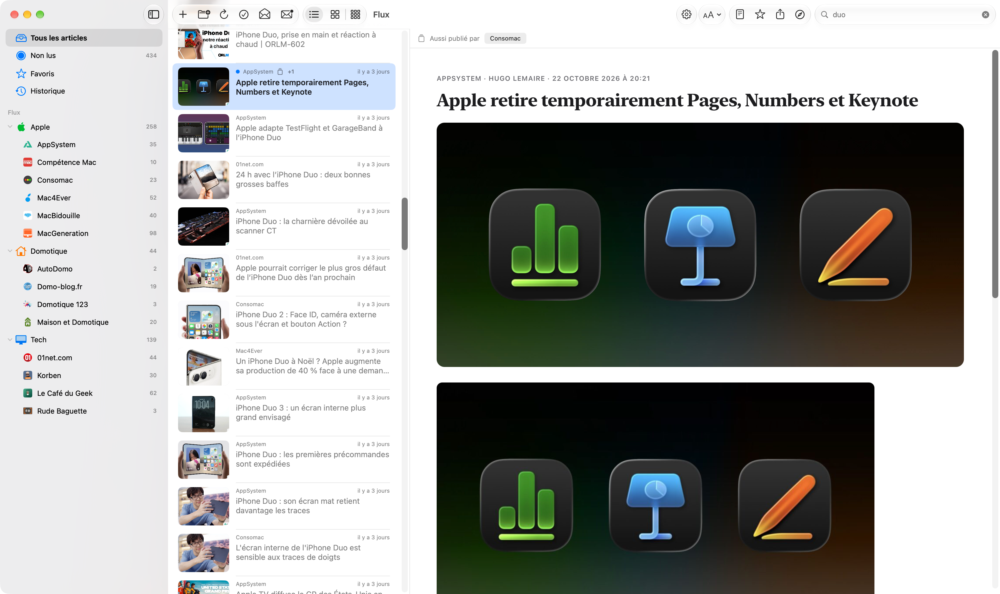
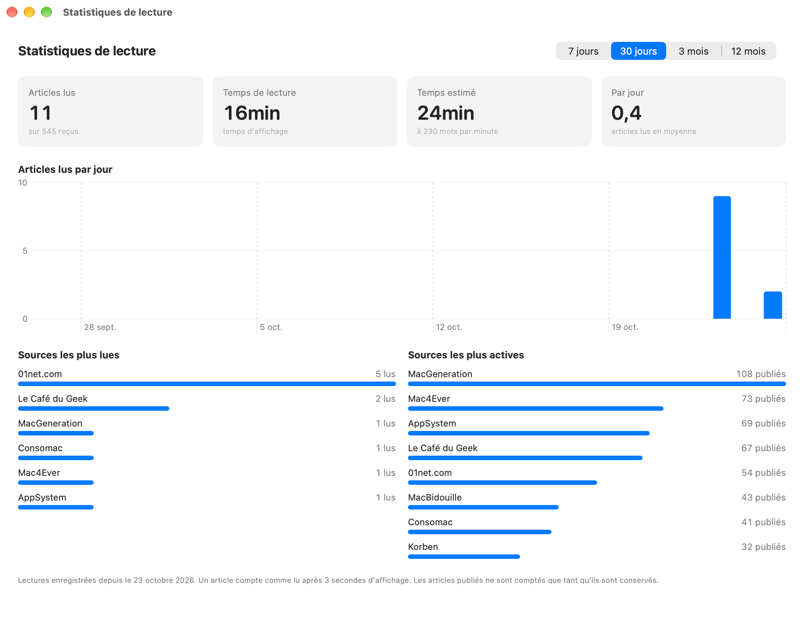
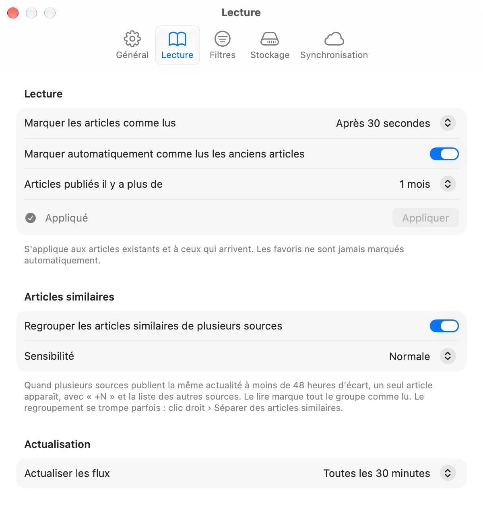
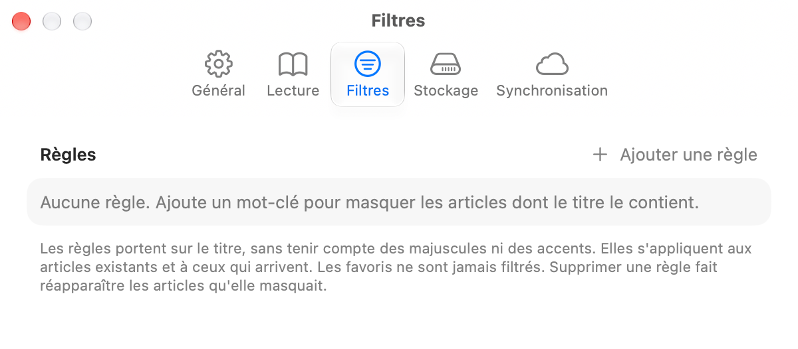

<p align="center">
  
</p>

<h1 align="center">Flux</h1>

<p align="center">
  
  
  
  <a href="LICENSE"></a>
</p>

<p align="center">
  <a href="README.md">🇬🇧 English</a> · 🇫🇷 Français
</p>

---

Flux est un lecteur RSS simple et soigné pour macOS.

Tu ajoutes tes flux toi-même (pas d'annuaire, pas de compte, pas de recommandations), tu parcours les articles en liste avec miniatures ou en vignettes, et tu lis **l'article complet directement dans l'app**, sans ouvrir ton navigateur. Tout reste sur ton Mac.

Flux est une app SwiftUI native, en français et en anglais, en mode clair et sombre.

## 📸 Captures d'écran

<p align="center">
  
</p>

| Liste avec miniatures | Vignettes en plein écran |
|:---:|:---:|
|  |  |
| **Articles similaires regroupés** | **Statistiques de lecture** |
|  |  |
| **Réglages de lecture** | **Règles de filtrage** |
|  |  |

## ✨ Fonctionnalités

### 📰 Tes flux, à ta façon

- **Ajouter un flux** (⌘N) en collant son adresse, ou simplement celle du site : Flux trouve le flux déclaré par le site, puis essaie les chemins habituels (`/feed`, `/rss`, `/atom.xml`…).
- **Dossiers** (⇧⌘N), repliables, avec leur propre total de non-lus, leur couleur et leur icône (clic droit › Personnaliser…). Glisse un flux sur un dossier pour l'y ranger.
- **Renommer un flux** (clic droit › Renommer…) quand son nom est à rallonge. Le nom d'origine est conservé, tu peux y revenir.
- **Import et export OPML** (menu Fichier, ⇧⌘I / ⇧⌘E) pour reprendre tes abonnements depuis un autre lecteur (NetNewsWire, Reeder, Feedly…) avec leurs dossiers, ou pour les sauvegarder.
- **Limites :** les dossiers imbriqués d'un fichier OPML sont ramenés au dossier le plus proche.

### 🖼️ Une liste agréable à parcourir

- Vue **Liste** avec miniature, source, date, titre et résumé (masquable), ou vue **Vignettes** (une grille d'images avec le titre dessous). On passe de l'une à l'autre dans la barre d'outils.
- Les miniatures viennent du flux (`media:thumbnail`, `enclosure`…), de la première image de l'article, ou en dernier recours de l'`og:image` de la page.
- **Vignettes en plein écran** (troisième choix du sélecteur de présentation, dans la barre d'outils) : la grille prend toute la largeur, et un article s'ouvre à sa place, avec une flèche de retour (ou Échap). Entrée ouvre l'article sélectionné.
- **Recherche** dans le titre et le texte complet des articles de la vue en cours.
- **Sélection multiple** (⌘-clic, ⇧-clic, ⇧↑/↓, ⌘A) pour marquer d'un coup plusieurs articles comme lus, non lus ou favoris.

### 📖 L'article complet, dans l'app

- Quand un flux ne donne qu'un extrait (court, ou coupé par « … » ou « Lire la suite »), Flux télécharge la page et en extrait l'article avec [Readability.js](https://github.com/mozilla/readability), le moteur du mode Lecture de Firefox. Un bouton permet de passer de la version du flux à l'article complet.
- Mise en page de lecture soignée, claire ou sombre, avec une taille de texte réglable (⌘+ / ⌘− / ⌘0) et trois largeurs de texte (étroite, large, toute la largeur). Les liens s'ouvrent dans ton navigateur par défaut.
- **Limites :** les articles réservés aux abonnés d'un site restent tronqués, puisque le site lui-même ne fournit pas la suite. Les pages entièrement construites en JavaScript peuvent être mal extraites : le bouton « Ouvrir dans le navigateur » est là pour elles.

### 🧲 Articles similaires

Quand plusieurs sources publient la même actualité à moins de 48 heures d'écart, Flux les regroupe : un seul article apparaît dans les listes, avec un badge « +N », et l'article affiche les autres sources pour lire leur version. Le lire marque tout le groupe comme lu.

- Les articles sont regroupés quand ils pointent vers le même lien, ou quand leurs titres partagent au moins deux mots distinctifs et sont assez proches, mot à mot ou par le sens (plongements de phrases du framework NaturalLanguage d'Apple, calculés sur ton Mac). Les mots présents dans beaucoup de titres du moment (« iPhone » une semaine de lancement) comptent très peu. Un groupe contient au plus un article par source, et un article doit ressembler au premier du groupe pour le rejoindre.
- Réglages › Lecture : activé par défaut, avec trois niveaux de sensibilité.
- **Limites :** le regroupement n'est jamais parfait. Il rate certains doublons dont les titres sont formulés très différemment, et peut parfois réunir deux actualités distinctes : clic droit › Séparer des articles similaires. La vue d'un flux affiche toujours tous ses articles.

### 🚫 Filtres par mots-clés

Des règles (Réglages › Filtres) excluent les articles selon un mot-clé dans leur titre, sans tenir compte des majuscules ni des accents : **masquer** l'article, ou simplement le **marquer comme lu**. Une règle vaut pour tous les flux ou pour un seul, pour le mot entier ou n'importe où dans le titre, et indique combien d'articles elle touche (avec un aperçu avant d'enregistrer).

- Les règles s'appliquent aux articles existants et à ceux qui arrivent ; les favoris ne sont jamais filtrés. Supprimer une règle fait réapparaître les articles qu'elle masquait.
- **Limite :** seul le titre est examiné, pas le texte de l'article.

### ⌨️ Raccourcis clavier, façon Reeder

| Touche | Action |
|---|---|
| j / k | Article suivant / précédent |
| Espace / ⇧ Espace | Faire défiler l'article (en bas : article suivant) |
| m | Marquer comme lu / non lu (toute la sélection) |
| s | Ajouter aux / retirer des favoris (toute la sélection) |
| b | Ouvrir dans le navigateur |
| ↑ / ↓ (← / → en vignettes) | Se déplacer dans la liste ; avec ⇧, étendre la sélection |
| Entrée / Échap | Ouvrir l'article / revenir aux vignettes (vignettes en plein écran) |
| ⌘N / ⇧⌘N | Ajouter un flux / nouveau dossier |
| ⌘R | Actualiser |
| ⇧⌘K | Tout marquer comme lu (vue en cours) |
| ⌘+ (ou ⌘=) / ⌘− / ⌘0 | Agrandir / réduire / taille par défaut du texte |
| ⌥⌘S | Statistiques de lecture |
| ⌘, | Réglages |

Les raccourcis à une touche sont ignorés pendant la saisie dans un champ de texte.

### ✈️ Lecture hors ligne

Quand elle est activée (Réglages › Hors ligne), Flux télécharge après chaque actualisation les articles non lus et les favoris en entier, **images comprises**, pour que tu puisses les lire sans connexion. Sans connexion, la barre d'outils affiche « Hors ligne ».

- Le cache d'images a une taille maximale (de 250 Mo à 5 Go, 1 Go par défaut) ; les images les moins récemment utilisées sont supprimées en premier. Sa taille est affichée dans les réglages, avec un bouton pour le vider.
- **Limites :** 25 images au maximum par article. La première préparation peut prendre quelques minutes si tu as beaucoup de non-lus.

### ⭐ Favoris, historique et nettoyage

- Les **favoris** sont conservés indéfiniment, même lus, et ne sont jamais marqués comme lus automatiquement.
- **Archive des favoris** (Réglages › Stockage, activée par défaut) : quand tu ajoutes un favori, l'article complet et ses images sont rangés dans une archive permanente, indépendante du cache hors ligne. Tu peux le relire même si le site le supprime, ou sans connexion. Retirer un favori libère sa place.
- L'**Historique** (barre latérale) liste les articles que tu as ouverts, du plus récent au plus ancien, et la recherche y fonctionne aussi.
- **Marquer les articles comme lus** immédiatement, après 5, 10 ou 30 secondes, ou jamais (Réglages › Lecture).
- En option, **marquer comme lus les anciens articles** au-delà de 1 jour à 1 mois, avec un aperçu du nombre d'articles concernés avant d'appliquer.
- Les articles lus qui ne sont pas en favoris sont **supprimés** après 2 semaines à 1 an (2 mois par défaut), ou jamais.
- Supprimer un flux supprime ses articles **sauf ses favoris**, qui restent dans Favoris (et retrouvent le flux si tu l'ajoutes à nouveau).

### 📊 Statistiques de lecture

Présentation › Statistiques de lecture (⌥⌘S) : articles lus, temps passé à lire, temps de lecture estimé (à 230 mots par minute), graphique des articles lus par jour, sources les plus lues et les plus actives, sur 7 jours, 30 jours, 3 mois ou 12 mois.

- **Limites :** les lectures sont enregistrées à partir de cette version (pas d'historique avant). Un article compte comme lu après 3 secondes d'affichage, et le temps passé est le temps où il est resté à l'écran, pas la preuve que tu l'as lu. Les articles publiés ne sont comptés que tant que Flux les conserve.

### ☁️ Synchronisation entre Mac

Réglages › Synchronisation : active-la sur chaque Mac (même compte iCloud) pour garder synchronisés tes **flux, dossiers, noms personnalisés, règles de filtrage, articles lus et favoris**. Flux écrit un petit fichier d'état par Mac dans `iCloud Drive/Flux/` et fusionne ceux des autres : quand un élément a changé sur les deux Mac, la modification la plus récente l'emporte, élément par élément.

- Non synchronisés : réglages, historique, statistiques et images (chaque Mac télécharge les siennes, archive des favoris comprise).
- **Limites :** iCloud Drive doit être activé ; les changements arrivent aussi vite qu'iCloud Drive transporte les fichiers (en général en moins d'une minute). Flux passe par iCloud Drive plutôt que CloudKit, qui exige un compte développeur Apple payant. La première fois, macOS peut demander l'autorisation d'accéder à iCloud Drive.

### ⚙️ Réglages

Les réglages sont rangés en cinq onglets (Général, Lecture, Filtres, Stockage, Synchronisation) : apparence (automatique, clair, sombre), langue (système, français, anglais), résumé sous le titre, largeur du texte de l'article, délai avant de marquer comme lu, intervalle d'actualisation (de 15 minutes à 6 heures), lecture hors ligne et stockage.

## 🧩 Compatibilité

**macOS 14 (Sonoma) ou plus récent**, sur Mac Apple Silicon et Intel.

Formats de flux : **RSS 2.0**, **RSS 1.0 (RDF)**, **Atom** et **JSON Feed**, servis en `https` ou en `http`.

## 🔐 Autorisations nécessaires

Aucune. Flux n'a besoin d'aucune autorisation particulière : il utilise seulement le réseau pour télécharger tes flux, leurs articles et leurs images.

## 🔒 Confidentialité

Flux ne collecte rien et n'envoie rien te concernant. Pas de compte, pas de statistiques, pas de pistage. En dehors de la synchronisation facultative par ton propre iCloud Drive, les seules requêtes réseau vont directement aux sites auxquels tu es abonné : leurs flux, les pages de leurs articles, leurs images et leurs favicons. Tout est stocké sur ton Mac :

- articles, flux et dossiers : `~/Library/Application Support/Flux/Flux.store` ;
- cache d'images : `~/Library/Application Support/Flux/Images` ;
- archive des favoris : `~/Library/Application Support/Flux/Archive` ;
- synchronisation (si activée) : un fichier par Mac dans `iCloud Drive/Flux/devices/`, dans ton propre iCloud.

## 📥 Installation

Il n'y a pas encore de version à télécharger : pour l'instant, Flux se compile depuis les sources (voir plus bas). Ça prend deux minutes avec Xcode.

## 📝 Historique des versions

### 0.2
- Prise en charge de JSON Feed, vignettes en plein écran, filtres par mots-clés, archive des favoris et Historique, statistiques de lecture, regroupement des articles similaires de plusieurs sources, réglages en onglets.

### 0.1
- Première version : flux et dossiers ajoutés à la main, vues liste et vignettes, lecture de l'article complet avec Readability, recherche, sélection multiple, raccourcis façon Reeder, lecture hors ligne, import/export OPML, réglages, français et anglais, mode clair et sombre.

## 🛠️ Compiler depuis les sources

Prérequis : Xcode 15 ou plus récent, macOS 14 ou plus récent, et [XcodeGen](https://github.com/yonaskolb/XcodeGen) (le projet Xcode est généré à partir de `project.yml`).

```bash
brew install xcodegen
git clone https://github.com/Aervorn/MacOS_Flux.git
cd MacOS_Flux
xcodegen generate
open Flux.xcodeproj
```

Choisis le schéma **Flux** et **Mon Mac**, puis **Product › Run** (⌘R). Le projet est réglé sur **Sign to Run Locally** : aucun compte développeur Apple n'est nécessaire.

Après un `git pull` qui ajoute ou supprime des fichiers, relance `xcodegen generate`.

```
Flux/
├── FluxApp.swift          point d'entrée, base SwiftData, fenêtres et menus
├── Models.swift           Feed, Folder, Article
├── FeedParser.swift       parser RSS / Atom et dates
├── FeedStore.swift        ajout, actualisation, préparation hors ligne, OPML, nettoyage
├── ArticleExtractor.swift Readability.js dans un WKWebView invisible
├── ImageCache.swift       cache d'images sur disque, protocole flux-image://, miniatures
├── HTMLUtils.swift        texte brut, entités, images, découverte de flux
├── OPML.swift             import / export OPML
├── Keyboard.swift         raccourcis à une touche
├── Settings.swift         réglages, apparence, langue
├── Views/                 interface SwiftUI
├── en.lproj / fr.lproj    traductions
└── Resources/Readability.js
Design/                    icône de l'app (SVG, et le script Python qui génère les PNG)
```

## 🤝 Contribuer et signaler un problème

Les signalements de bugs, les idées et les pull requests sont les bienvenus !

- **Un flux qui se charge mal ?** [Ouvre une issue](https://github.com/Aervorn/MacOS_Flux/issues/new) avec l'adresse du flux, ta version de macOS, ce que tu attendais et ce qui s'est passé. Une capture d'écran aide beaucoup.
- **Une idée ?** Ouvre d'abord une issue pour en discuter.
- **Une pull request ?** Garde-la centrée sur un seul changement. Les textes de l'interface sont écrits en français dans le code ; ajoute la traduction anglaise de tout nouveau texte dans `Flux/en.lproj/Localizable.strings`.

## ⚠️ Avertissement

Flux est fourni **« tel quel », sans aucune garantie**. L'auteur ne peut être tenu responsable d'une perte de données ou de tout autre dommage. Tu l'utilises à tes propres risques.

Flux n'est affilié à aucun des sites dont tu lis les flux. Les articles, images et logos appartiennent à leurs auteurs respectifs.

## 📄 Licence

Flux est distribué sous [licence MIT](LICENSE).

L'extraction des articles utilise [Readability.js](https://github.com/mozilla/readability) de Mozilla, distribué sous licence Apache 2.0 (voir `Flux/Resources/Readability-LICENSE.md`).
